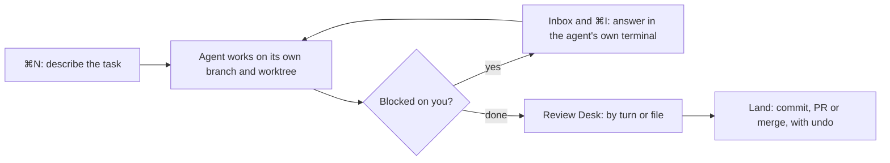

<p align="center">
  
</p>

<h1 align="center">Hermes IDE</h1>

<p align="center">
  <strong>One console for every coding agent.</strong><br>
  Run Claude Code, Codex, Copilot, OpenCode and the rest side by side, each in its own terminal and its own worktree.<br>
  See which one needs you, review what it changed, and land it.
</p>

<p align="center">
  <a href="https://hermes-ide.com/download"><strong>Download</strong></a> &middot;
  <a href="https://hermes-ide.com">Website</a> &middot;
  <a href="https://hermes-ide.com/changelog">Changelog</a> &middot;
  <a href="https://discord.gg/vMQXSTY6BM">Discord</a>
</p>

<div align="center">

[](https://github.com/hermes-hq/hermes-ide/releases/latest)
[](https://hermes-ide.com/download)
[](LICENSE)
[](https://github.com/hermes-hq/hermes-ide/actions/workflows/ci.yml)
[](https://github.com/hermes-hq/hermes-ide/actions/workflows/release.yml)
[](https://discord.gg/vMQXSTY6BM)
[](https://github.com/sponsors/hermes-hq)

</div>


Hermes IDE is a desktop app for macOS, Windows and Linux. Every agent runs its own interface in a real terminal, exactly as it would anywhere else, so a vendor's new commands and modes work in Hermes the day they ship. Around those terminals, Hermes adds what no single agent gives you: a separate branch and worktree for each task, one status for every agent, an inbox for the ones blocked on you, and a place to review and merge their work. It works the same way for every vendor, with your own sign-ins.

Hermes IDE is not affiliated with Nous Research or its Hermes Agent.

---

## Why Hermes

If you run more than one coding agent a day, these are the problems Hermes is built for.

| The problem | What Hermes does |
|---|---|
| Two agents in one checkout overwrite each other. | **⌘N** starts each task on its own `hermes/<name>` branch in its own worktree, with the task as the agent's first prompt. New worktrees get their dependencies in seconds and their own ports. |
| You can't tell which agent is waiting on you. | Every session shows one status: working, needs approval, asked you, done, error or idle, and says when it is a guess. The attention inbox counts the agents blocked on you, and **⌘I** jumps to the one that has waited longest. |
| Agent changes arrive as one big diff. | Every agent turn is saved, so you can diff or restore any single turn, with undo. The **Review Desk** (⌘G) shows changes by turn or by file with risk flags, and sends a line comment back to the agent that wrote it. |
| Merging agent work feels risky. | **Land** commits, opens a pull request or merges locally in one step, into the branch the task started from, and can be undone. Your own checks can decide when a task is done. |
| You're tied to one vendor. | Pick the agent, model, effort and account per task, and save combinations you use often as presets. Several accounts per agent are supported. When one agent hits its usage limit, continue the task in another. |
| Closing the app kills running agents. | On macOS and Linux, agents keep working while Hermes quits, updates or crashes, and you reattach where they left off. |

### How a task flows



Hermes observes what agents report on purpose and what git shows. It never answers a permission prompt for you and never types into a terminal on its own.

---

## Quick start

1. **Install Hermes.** Download it from [hermes-ide.com/download](https://hermes-ide.com/download): macOS (Apple Silicon and Intel), Windows, or Linux (.deb and AppImage). Releases are also on [GitHub](https://github.com/hermes-hq/hermes-ide/releases/latest).
2. **Open it and pick your agents and a repo.** A three-step setup shows the agent CLIs you have, such as Claude Code or Codex, and whether each is signed in with its own login. Then choose a git repository.
3. **Describe your first task.** The agent starts in a terminal on its own branch, with the task as its first prompt. After that, **⌘N** (Ctrl+Shift+N on Windows and Linux) starts the next task, ⌘I takes you to the agent that needs you, and ⌘G opens its changes for review.

| Action | macOS | Windows / Linux |
|---|---|---|
| New task | ⌘N | Ctrl+Shift+N |
| Jump to the agent waiting longest | ⌘I | Ctrl+Shift+I |
| Review Desk | ⌘G | Ctrl+Shift+G |
| Prompts | ⌘J | Ctrl+Shift+M |
| Command Palette | ⌘K | Ctrl+Shift+K |

All shortcuts are in [docs/shortcuts.md](docs/shortcuts.md).

---

## Features

### Every agent, in its own terminal
- **Every agent in its own terminal** — Claude Code, Codex, Antigravity CLI, Gemini CLI, GitHub Copilot CLI, OpenCode, goose, Aider, Kiro CLI, Hermes Agent, any command-line agent you add, and plain shells each open in a real terminal by default, running the agent's own interface <!-- claim:every-agent-terminal -->
- **Bring your own auth** — agents use their own CLI sign-in (for Claude: Pro, Max or an API key); Hermes never asks for tokens <!-- claim:agent-own-auth -->
- **Multi-session management** — run parallel sessions, switch between them and keep them organized <!-- claim:multi-session -->
- **Split panes** — split right or down to run sessions side by side; close a pane and the others fill the space <!-- claim:split-panes -->
- **Fast terminal rendering** — GPU-accelerated (WebGL) where the system supports it, clickable web links, and auto-fit to the window <!-- claim:webgl-rendering -->
- **Remembers your choice per agent** — the New Session wizard preselects the last agent and how you ran it <!-- claim:remember-agent-choice -->

### Agent view for Claude (optional)
- **Opt in per session** — tick "Agent view for Claude" to have Hermes render the conversation instead of Claude's terminal interface; the terminal stays the default <!-- claim:agent-view-opt-in -->
- **Structured conversation** — thinking blocks, tool-call cards and diff previews <!-- claim:agent-chat -->
- **Real images** — paste images straight into the composer; Claude sees the actual pixels <!-- claim:agent-images -->
- **Persistent conversations** — Agent-view sessions come back after an app restart with the earlier conversation on screen, and Claude continues it <!-- claim:agent-persistent-conversations -->

### Review and git
- **Built-in git view** — the Review Desk lists staged, unstaged and untracked files per project <!-- claim:git-panel -->
- **Stage / unstage / commit / discard / push / pull** — all from the Review Desk <!-- claim:git-actions -->
- **Inline diff viewer** — click any changed file to see its diff, with removed and added lines marked <!-- claim:git-diff -->
- **Push with your own credentials** — pushes sign in with your git credential helper (such as Git Credential Manager) or a `GITHUB_TOKEN`, and say how to sign in when nothing works <!-- claim:git-auth -->

### Prompts and project context
- **Prompts** (⌘J) — find a ready-made prompt from the free [Hodios](https://github.com/hermes-hq/hodios) library (10,000+ prompts, personas, workflows and rules) or one of your own, fill in the blanks and put it in the session or a new task <!-- claim:prompt-composer -->
- **Automatic scanning** — detects each project's languages, frameworks, architecture and conventions <!-- claim:project-scanning -->
- **Context injection** — your agent is pointed at a context file with what the scan found, kept within a token budget you can set per project <!-- claim:context-injection -->
- **Multi-project support** — attach several projects to one session; their context reaches the agent together <!-- claim:multi-project -->
- **Memory & context pins** — facts and pinned files saved for a project reach every later session's agent, also after a restart <!-- claim:memory-pins -->
- **Ghost-text suggestions** — completions from your command history as you type; → accepts them (in shells without suggestions of their own) <!-- claim:ghost-text -->

### Staying in control
- **System notifications** — a notification when an agent is blocked on you or done, never for the session you are already looking at <!-- claim:notifications -->
- **Spend per session** — the cost an agent reports, or an estimate from its transcript clearly marked as estimated, with token totals <!-- claim:session-spend -->
- **Stuck detection** — when an Agent-view session ignores Stop, Hermes tells you it isn't responding and offers Force stop, keeping the conversation <!-- claim:stuck-detection -->
- **Command Palette** — type to find and run any action <!-- claim:command-palette -->

The full New Session window also covers SSH and tmux sessions ([docs/ssh-remote-sessions.md](docs/ssh-remote-sessions.md)). Worktree setup per repository is described in [docs/worktree-recipes.md](docs/worktree-recipes.md).

---

## Building from source

[](https://tauri.app)
[](https://react.dev)
[](https://www.rust-lang.org)
[](https://www.typescriptlang.org)

You need [Node.js](https://nodejs.org) 20+, [Rust](https://rustup.rs) (the version is pinned in `rust-toolchain.toml`) and the [Tauri system dependencies](https://v2.tauri.app/start/prerequisites/) for your platform. [BUILDING.md](BUILDING.md) lists the exact packages for macOS, Windows and Linux.

```bash
git clone https://github.com/hermes-hq/hermes-ide.git
cd hermes-ide
npm ci
npm run tauri dev           # full app with hot reload
npm run tauri build         # production build
```

Checks before a pull request:

```bash
npx tsc --noEmit            # type check
npm run test                # frontend tests
cd src-tauri && cargo test  # Rust tests
```

### Architecture in one paragraph

Hermes IDE is a [Tauri 2](https://tauri.app) app. The frontend is React and TypeScript; the Rust backend owns the terminals, git, the background session host and local persistence. The optional Agent view for Claude runs the Claude Agent SDK in a small per-session bridge. [ARCHITECTURE.md](ARCHITECTURE.md) has the details, and [ADR 003](docs/adr/003-terminal-first-vendor-neutral.md) explains why Hermes is terminal first and vendor-neutral.

---

## Documentation

- [Architecture Guide](ARCHITECTURE.md) — how the codebase is structured and why
- [Building](BUILDING.md) — build from source on every platform
- [Design Principles](DESIGN_PRINCIPLES.md) — what Hermes IDE is and isn't
- [Governance](GOVERNANCE.md) — how decisions are made
- [Keyboard shortcuts](docs/shortcuts.md)
- [Plugin API](docs/plugin-api-v2.md)

---

## Contributing

Contributions are welcome. Before you start, read:

- [CONTRIBUTING.md](CONTRIBUTING.md) — what we accept and how pull requests work
- [DESIGN_PRINCIPLES.md](DESIGN_PRINCIPLES.md) — our anti-bloat philosophy
- [CLA.md](CLA.md) — the Contributor License Agreement, required for every contribution
- [Code of Conduct](https://github.com/hermes-hq/.github/blob/main/CODE_OF_CONDUCT.md) — be kind

**The #1 rule:** open an issue or discussion before writing code for a new feature. Bug fixes and docs don't need prior discussion.

---

## License

Hermes IDE is source-available under the **[Business Source License 1.1](LICENSE)** (BSL 1.1).

- **You can** copy, modify, create derivative works, redistribute, and use it freely for non-production purposes. Production use is allowed as long as it does not compete with Hermes IDE.
- **You cannot** use it to build a competing code editor, terminal emulator or IDE offered to third parties.
- **Three years after each release**, that release's code converts to the **Apache License 2.0**.

All contributions require signing the [Contributor License Agreement](CLA.md).

---

## Security

Found a vulnerability? Please report it responsibly to [ga.contact.me@gmail.com](mailto:ga.contact.me@gmail.com). See the [Security Policy](https://github.com/hermes-hq/.github/blob/main/SECURITY.md) for details.

---

## Sponsors

Hermes IDE is built and maintained by a small team. If it saves you time, please consider [sponsoring](https://github.com/sponsors/hermes-hq) to keep the project going.

[](https://github.com/sponsors/hermes-hq)
[](https://github.com/sponsors/hermes-hq)

| Tier | Monthly | Perks |
|------|---------|-------|
| ☕ Supporter | $5 | Sponsor badge |
| 🚀 Backer | $20 | Badge + release notes mention |
| 💎 Contributor | $50 | Badge + README credit + early access |
| 🤝 Partner | $100 | Logo in README + priority bug reports |
| 🏢 Company | $500 | Logo on website + direct support channel |

See [SPONSORS.md](./SPONSORS.md) for the full list of sponsors.

---

<p align="center">
  <a href="https://hermes-ide.com">Website</a> &middot;
  <a href="https://hermes-ide.com/download">Download</a> &middot;
  <a href="https://github.com/hermes-hq/hermes-ide/discussions">Discussions</a> &middot;
  <a href="https://discord.gg/vMQXSTY6BM">Discord</a> &middot;
  <a href="https://hermes-ide.com/changelog">Changelog</a>
</p>
